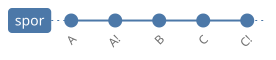

# Spor

Spor tracks your changes, turns them into a coherent Git history, validates every commit, and automatically makes fixup commits, as needed.

Spor will work in an adjacent branch/worktree to validate and fix-up commits, when you're ready, it will rebase those fixup commits back into your original branch.

Spor will analyze the staged changes to detect and extract refactor commits.

Spor's operational validation runs its configured check and records the outcome.
A successful operational validation does not by itself claim semantic verification of behavior preservation.

## Refactor confidence

The Language section of `CONTEXT.md` distinguishes validation from verification.
Validation records the result of an operational check, such as existing tests.
Verification is conditional formal confidence from checked language-semantic conditions that imply behavior preservation under stated assumptions.

For example, a verified variable rename requires the renamed references to retain their bindings to the renamed declaration and untouched references to retain their original bindings.
It also requires checking that no conflicts or capture change name resolution.
These checks must cover the relevant code and build configurations, and the stated assumptions must support the behavior-preservation claim.

A tool such as `gopls` is a candidate for performing or assisting with these checks, not automatic proof.
A `Verified` claim depends on the conditions actually checked, the tool's guarantees and version, the scope and build configurations covered, and the assumptions made.
Compilation or static acceptance alone is insufficient.
Tests complement verification and remain required by the project workflow.

Commit subjects can distinguish the evidence behind a refactor:

- `Refactor: Verified variable rename, foo`
- `Refactor: Verified extract function, foo()`

These are illustrative subjects, not claims that either refactor has been performed or verified.

## Example Workflow

In this workflow, validation and its success or failure refer to Spor's operational check, not semantic verification.

| User | User Branch | Spor Branch | Spor |
| --- | --- | --- | --- |
| User runs `spor start` |  |  | Spor spawns a daemon |
| User makes changes | \* |  |  |
| User stages changes | \* |  |  |
| User runs `spor add` | \* |  |  |
| User continues making changes | \* |  | Spor receives staged changes |
|  |  |  | Spor analyzes staged changes and extracts 3 commits, A, B, and C, to Spor Index |
|  |  | A | Spor checks out A to Spor Branch and begins validation |
|  |  | A - A! | Validation fails, Spor makes a fixup commit, and restarts validation |
|  |  | A - A! - B | Validation succeeds, Spor pulls in commit B and starts validation |
|  |  | A - A! - B - C | Validation succeeds, Spor pulls in commit C and starts validation |
|  |  | A - A! - B - C - C! | Validation fails, Spor makes a fixup commit, and restarts validation |
| User runs `spor rebase` | A - A! - B - \* |  |  |
| User commits `git commit` | A - A! - B - D |  |  |
|  |  | A - A! - B - C - C! | Validation succeeds |
| User runs `spor rebase` | A - A! - B - D - C - C! - \* |  |  |

Spor's branch before the first rebase.



After the first rebase, the user commits D.


After the second rebase, Spor's branch matches the user's.


- `A`
  - `Change-Id: C1`
  - `Spor-Id: S1`
- `A'`
  - `Change-Id: C2`
  - `Fixup-Id: C1-1`
- `B`
  - `Change-Id: C3`
  - `Spor-Id: S1`
- `C`
  - `Change-Id: C4`
  - `Spor-Id: S1`
- `C'`
  - `Change-Id: C5`
  - `Fixup-Id: C4-1`

## Spor Commands

- `spor start` - Starts Spor daemon in the current Git worktree.
- `spor daemon` - Runs the Spor daemon in the current Git worktree.
  `--auto` also runs the auto-submit watcher inside the daemon process; `spor start --auto` is equivalent.
- `spor status` - Displays the latest submission and recorded validation for every feature-branch commit selected from the branch boundary.
  It also displays independent static verification results for those exact commits.
  Uncached results are pending; status does not run validation or verification.
- `spor add` - Queues the staged changes for the daemon to process.
  `spor stage` is an alias for `spor add`.
- `spor auto-submit` - Watches stable tracked working changes and queues immutable snapshots for the daemon.
  The daemon extracts and validates refactor-only commits, then publishes them onto the current branch without writing working files.
  Run it alongside `spor daemon`, or use `spor daemon --auto` to run both loops in one process.
- `spor reset` - Undoes the latest `spor add`.
- `spor log` - Shows added commits that are not yet on the user's branch with validation status.
- `spor rebase` - Queues integration of validated Spor commits into the current branch.
  `spor status` reports the outcome.
  The branch must be attached, and the worktree and index must be clean, with no Git operation in progress.
  Spor prepares the validated prefix and the remaining pending commits together.
  A conflict in either part can block the whole request without changing the user's branch or Spor history.
  After a partial integration, `spor add` is refused until the remaining Spor commits are integrated.
- `spor validate` - Queues a validation run. `--mode` selects the mode for that run.
- `spor gh auth login` - Stores a read-only GitHub token in the system keyring.
  Without flags it opens a pre-filled fine-grained token creation page, waits for the token to be pasted, validates it, and stores it; `--token` stores one without prompting, `--import-gh` copies the token the gh CLI already holds, and `--no-open` prints the URL without opening a browser.
- `spor gh auth status` - Reports the token source, owner, scopes, and rate limit.
- `spor gh watch-pr` - Watches the pull request for the current feature branch.
  It polls check runs and combined statuses, saves failure logs under the worktree Git directory, and prints the fetch commands to reproduce the pull request locally.
  `--once` polls a single time; `--interval` and `--timeout` control watching; `--logs-dir` selects where failure logs go.
- `spor stop` - Stops the Spor daemon.

## Automatic submission

Run `spor daemon --auto` to watch, validate, and publish supported working refactors in a single process.
Alternatively, run `spor daemon` in one terminal and `spor auto-submit` in another, in the same worktree.
Plain `spor daemon` does not start a watcher.
In `--auto` mode, stopping the daemon also stops its watcher and waits for it to release its lock and publication authorization.
A watcher failure stops the combined daemon and returns an error; an already-running standalone watcher causes `spor daemon --auto` to fail rather than start a second watcher.
The watcher polls once per second and waits for two matching observations before submitting a snapshot.
It uses an alternate index, so capturing working changes does not stage them in your index.
Untracked files are excluded.

The daemon extracts supported refactors from the snapshot without committing the unfinished feature changes that remain.
It validates each exact candidate commit in its isolated checkout using the configured operational check.
A passing check is validation, not a claim of semantic verification.
Missing configuration, validation failures, or infrastructure errors prevent publication.
This first version does not run fixup agents for auto-submissions; it will not automatically publish agent changes that are absent from your working files.

Automatic publication requires an attached branch, a clean index, no Git operation in progress, and no unintegrated manual Spor commits.
Sparse, skip-worktree, and assume-unchanged index entries are unsupported.
Before publication, Spor checks that the captured branch, tip, index bytes, and tracked working snapshot still match.
If you edit, stage, switch branches, or start a rebase during validation, Spor skips that candidate and the watcher can submit a fresh snapshot once the worktree is ready.
A failed or skipped snapshot is not repeatedly submitted while its inputs remain unchanged.

Publication advances the branch and replaces the index with the validated commit's tree, leaving working files untouched.
The refactor disappears from your uncommitted diff, while unrelated working changes remain.
Spor uses an exclusive Git index lock, a conditional branch update, and a SQLite publication journal in the worktree Git directory.
On restart, the daemon completes or rolls back an interrupted publication when the recorded branch and index still match.
If they no longer match, it logs an error instead of overwriting newer staging or another process's index lock.
External Git commands and editor writes cannot be made atomic with publication; avoid changing branches or running Git mutations at the instant Spor publishes.

Stopping `auto-submit` disables further automatic processing; an already-started publication can still finish.
A crashed watcher loses its publication authorization after five seconds unless it is restarted.
Manual `spor add`, `spor validate`, and `spor rebase` keep their existing behavior.
Auto-submissions have separate state and never become manual submissions in `spor log` or `spor reset`.
Without the watcher, the daemon does not extract working changes or initiate new automatic publications.
Interrupted publications can still be recovered without a watcher.

The daemon and watcher emit timestamped `log/slog` action logs on stderr, whether run separately or together with `--auto`.
The daemon logs request processing, validation starts and results with commit hashes and durations, fixup attempts for manual submissions, and automatic publication or deferral.
The watcher logs startup, working-change detection, submission, and changes in pause reasons such as staging or a rebase in progress.
Unchanged polling states are not repeatedly logged.
Validation command output also goes to stderr.

## Static Verification

The daemon checks feature-branch commits independently of configured validation, including when validation is missing or fails.
A verified result currently covers only a one-parent commit modifying exactly one existing regular Go file without changing its mode, with no sibling Go files in that directory.
Both versions must be self-contained, import-free, type-check under Go 1.27 rules, and use the verifier's restricted syntax.
The change must rename one referenced, explicitly declared local variable and its uses while preserving all other tokens and identifier bindings.
The check assumes local variable names have no runtime semantic significance and excludes debug metadata and observation of source positions.
Other changes are unsupported or rejected, not verified; verification is not a replacement for validation.
Results are cached by commit and analyzer version, and status reads the cache without performing analysis.

## Change Tracking

Spor will add a Change-Id Git commit message trailer to identify commits similar to what Gerrit Code Review does.
Spor will also track fixup commits with a Fixup-Id Git commit message trailer to identify commits that are fixups of other Change-Id.
Spor will add a Spor-Id Git commit message trailer to identify changes that were committed to Spor.

## Daemon Components

- Smith: The Smith will extract commits from the added changes and maintain an isolated Git Index to build commits.
- Auditor: The Auditor will validate commits and make fixup commits for any that fail validation.
- Mender: The Mender will incorporate Spor commits back into the User's branch/worktree.

## Milestones

### 0.1.0

- Spor will automatically extract and commit basic refactor commits from your staged changes.
- `spor add` writes those commits and leaves the branch, index, and worktree alone.
- `spor status` shows the latest submission.

### 0.2.0

- Spor will automatically validate commits.
- The validation modes are commit, patch, and change, and the default mode is change.
- The daemon validates unvalidated commits from the oldest forward and stops at the first failure.
- `spor validate` queues a check again, and `--mode` selects the mode for that run.
- `spor status` shows the validation outcome.

### 0.3.0

- Spor automatically makes fixup commits for commits that fail validation.
- The daemon owns the spor worktree and runs the Smith and Auditor.
- `spor add` and `spor validate` queue work for the daemon instead of running it in process.

### 0.4.0

- Spor will rebase fixup commits back into your original branch at your request.

### 0.5.0

- Spor monitors GitHub PR statuses for the current feature branch.
- `spor gh auth login` stores a read-only token, and `spor gh auth status` reports its scopes.
- `spor gh watch-pr` polls the pull request checks and fetches failure logs for reproduction.
- GitHub monitoring stays an extension; it does not replace local validation.

## Future Ideas

Spor could ensure Red-Green for tests on feature branch.

Spor would be able to chat with you wherever you work, whether that's in your IDE, in a terminal, or in an instant messenger.

Spor would automatically extract and commit quasi-refactor commits from your staged changes.
Quasi-refactor commits are commits that are not strictly refactors, but are still simple enough and self-contained enough do not having a user-facing change.

Spor would also provide code review and suggest commits rather than automatically making them.

Tightly integrate something like hk into the validation process.

## Usage

The feature-branch snapshot selector captures the current branch ref, its tip, a boundary, and every commit reachable from the tip but not the boundary, with parents before children.
When `push.default` is `current` and the upstream branch has a different branch name from the current branch, it uses the upstream commit as the boundary.
For this comparison, `refs/remotes/origin/feature` tracking `refs/heads/feature` has the same branch name as the local `refs/heads/feature`; the different ref namespaces do not make the branches different.
Otherwise the boundary is `git merge-base --fork-point origin/HEAD <tip>`.
If that fork point cannot be found, selection fails rather than using an ordinary merge base or the entire history.
A detached HEAD also fails; check out a branch before selecting a snapshot.
This selector is preparation for automatic branch validation and is separate from pending Spor commits used by Mender and fixups.

Spor reads configuration from four locations in order of increasing priority.
A later file replaces only the fields it sets.
Spor skips a file that is absent.
The mode defaults to `change`.

- Global configuration is `~/.config/spor/config.json`.
- Repository configuration is `spor/config.json` in the Git common directory.
- Worktree configuration is `spor/config.json` in the worktree Git directory when that path is separate from the Git common directory.
- Worktree root configuration is `.spor/config.json` at the root of the current Git worktree.

The `spor config` write commands still target the worktree Git directory by default, or the selected global or repository scope; they do not write the worktree root file.

`auditor.validate.command` is the program and its arguments.
`auditor.validate.mode` is `commit`, `patch`, or `change`.
These operational configuration names and Spor's validation statuses do not themselves imply semantic verification.
If an existing configuration uses `auditor.verify`, move that object to `auditor.validate` in each affected file before running Spor.
Spor reports the file that needs updating instead of silently ignoring the old settings.
`auditor.fixup.model.provider` and `auditor.fixup.model.version` select the `pi` agent.
`auditor.fixup.model.effort` is a `pi` thinking level such as `low`.
`mender.conflict.model.provider`, `mender.conflict.model.version`, and `mender.conflict.model.effort` configure `pi` for resolving rebase conflicts.
The provider and version are required only when a conflict occurs, and effort defaults to `low`.
Spor prepares integration in an isolated checkout and checks the branch and worktree again before publication.
External Git commands can still race with publication, so avoid changing the branch or worktree while a rebase request runs.

The following `go test` command supplies validation when existing tests pass, not semantic verification.

```json
{
  "auditor": {
    "validate": {
      "command": ["go", "test", "./..."],
      "mode": "change"
    },
    "fixup": {
      "model": {
        "provider": "openai",
        "version": "gpt-5",
        "effort": "low"
      }
    }
  }
}
```
